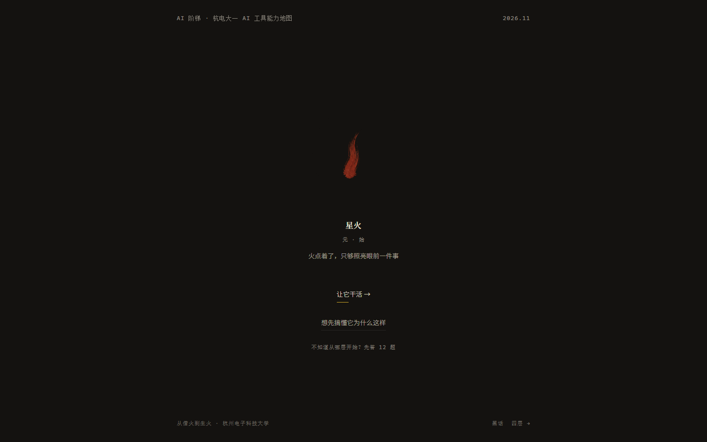
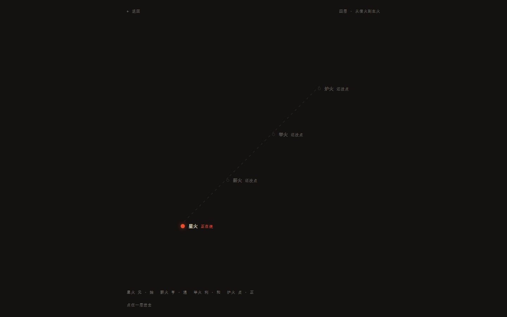
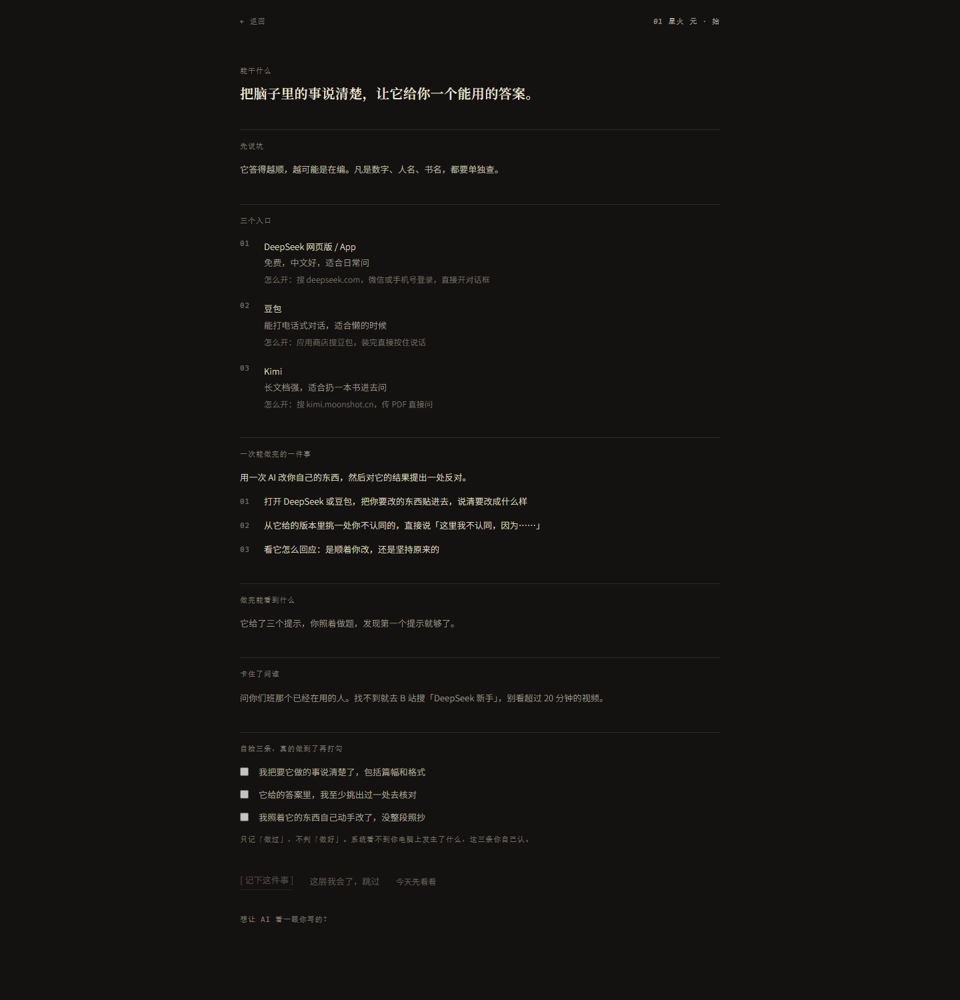
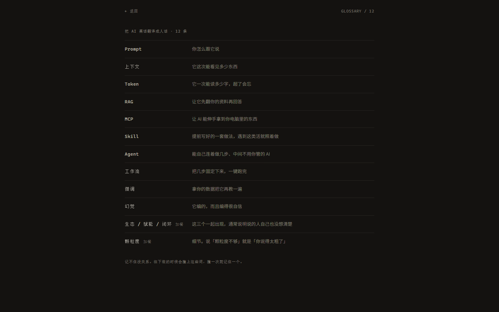

# AI 阶梯

> 杭州电子科技大学大一学生的 AI 工具使用能力地图。

课程考核作品 · 2026.11

一个人刚开始用 AI，卡住的不是"AI 是什么"，而是"我现在该打开哪个、打什么字"。

网上讲 AI 的内容不缺。缺的是把能力拆成台阶，每一级只说一件事：这一刻你能做什么、用哪个软件、做完怎么算数。



---

## 两条线

打开是两条路，它们是两种需求，不是深浅。

**让它干活** —— 四层台阶，从你会的开始。
**想先搞懂它为什么这样** —— 五个问题，每页先给一个你自己能试出来的现象，再给解释。

首页那张火换的是层：星火、薪火、举火、炉火四张，你在哪一层就亮哪一张。

---

## 四层台阶



| 层 | 这一层你会 | 具体是 | 一道题 |
|---|---|---|---|
| **星火** | 会聊天 | 把脑子里的事说清楚，让它给一个能用的答案 | 用一次 AI 改你自己的东西，然后对它的结果提出一处反对 |
| **薪火** | 会喂料 | 让它看你自己的材料，而不是它脑子里装的 | 把一份自己的材料喂进去，问一个材料里没直接写的问题 |
| **举火** | 会接工具 | 让它读你电脑里的文件、调你装好的软件 | 让 AI 碰到你电脑上的一个文件，完成一次改名或整理 |
| **炉火** | 会编排 | 把几步固定下来，让它自己跑 | 搭一条能自己跑的流，第二天不用管它 |

每层给三样东西：

- **一个任务**，拆成三步，具体到点哪个按钮
- **三个自检**，做完对着打勾，全勾上才算过这层
- **三个入口**，写明用哪个软件、怎么进去（DeepSeek / 豆包 / Kimi / Cherry Studio / Cursor / n8n …）

还有一句"这类人是谁"和一条"最常见的坑"。坑写在任务前面，不是做完才告诉你。

**每一层都可以跳过**。跳过的层在台阶图上显示"跳过了"，不算完成，也不拦你去下一层。



---

## 12 题测评

不知道从哪层开始，可以答 12 道题（每层 3 题，每题四个选项）。它只回答"从哪层开始"，不给你贴标签，也不封顶。

**测评不参与解锁。**解锁只看你自己打出的三个勾。

卡片页底部有个"想让 AI 看一眼"的入口，可选，要把题目和你的描述发给模型换一句参考意见。它不参与判定，默认是折叠的。

---

## 黑话页

12 个词，用人话讲一遍：Prompt、上下文、Token、RAG、MCP、Skill、Agent、工作流、微调、幻觉……

看一遍就够，不用记。



---

## 怎么跑

```bash
npm install
npm run dev
```

打开 http://localhost:3000。Node 18.17 及以上（Next.js 14 的要求）。

**不配任何环境变量也能跑完整流程。** "想让 AI 看一眼"才需要 key：

```bash
# .env.local
DEEPSEEK_API_KEY=sk-...
```

没配 key 时，那个入口改用关键词规则给意见——照样有结论，只是它读不懂"它说…""没给答案"这类同义说法。

---

## 技术栈

- Next.js 14（App Router）+ TypeScript
- Tailwind CSS
- 无状态管理库、无 UI 组件库、无数据库

```
app/          页面（首页、台阶、层卡、测评、结果、黑话、原理线五页）
components/   FireStage（火）、StepMap（台阶图）
content/      四层、五页原理、12 条黑话、12 道题、评分判据（JSON）
lib/          主题色、进度读写、评分、解锁规则
scripts/      两个探针脚本，用来核对页面上的实际渲染结果
```

---

## 还没做的

- 没有账号系统
- 题库只有 12 题，样本小，只能区分大概位置
